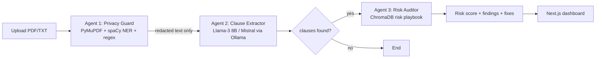

# Agentic Privacy Guard & Automated Contract Risk Auditor

Final-year AI/ML project. A multi-agent system that lets small businesses upload an NDA or SaaS agreement,
**redacts personal data first**, extracts the key clauses with a **local LLM**, and flags risky terms by
comparing them with a **legal-risk vector database**. Everything runs on your machine, so no contract text is sent to a cloud API.

> Disclaimer: automated analysis for awareness only, not legal advice.

## 1. Problem statement
Small businesses sign contracts containing hidden liabilities (uncapped indemnity, broad non-competes, auto-renewal traps, data-selling rights) because lawyers are expensive. Cloud AI tools are risky too, since uploading a contract leaks client names, emails and IDs. This project addresses both problems.

## 2. Architecture (LangGraph)

| Agent | Job | Tech |
|---|---|---|
| Privacy Guard | Parse PDF, redact PERSON (NER), email, phone, PAN, Aadhaar, SSN with stable tokens like `[EMAIL_1]`; raw text is dropped from graph state | PyMuPDF, spaCy, regex |
| Clause Extractor | Pull clauses as structured JSON (type, text, summary) in chunks; keyword fallback if Ollama is offline | Ollama, LangChain |
| Risk Auditor | Embed each clause, find the nearest risky pattern (cosine distance), flag below a threshold, compute 0-100 score | ChromaDB |

Design points to highlight: privacy-by-design (the LLM only sees redacted text), conditional routing in the graph, graceful degradation, and explainable output (each flag has a reason and a suggested fix).

## 3. Setup
```bash
# prerequisites: Python 3.10+, Node 18+, Ollama (https://ollama.com)
ollama pull llama3:8b            # or: ollama pull mistral  (then set OLLAMA_MODEL=mistral)

python -m venv .venv && source .venv/bin/activate      # Windows: .venv\Scripts\activate
pip install -r requirements.txt
python -m spacy download en_core_web_sm

cd backend && uvicorn app.main:app --reload             # API on :8000 (docs at /docs)

cd ../frontend && npm install && npm run dev            # UI on :3000
```
Test with `sample_data/sample_nda.txt`. Run unit tests: `cd backend && pytest`.
Config via env vars: `OLLAMA_MODEL`, `OLLAMA_URL`, `RISK_DISTANCE` (default 0.55; lower = stricter).

## 4. API
`POST /api/analyze` (multipart `file`) returns agent trace, redaction counts, redacted preview, clauses, findings (severity, similarity, explanation, recommendation) and summary score. `GET /api/health`.

## 5. Suggested evaluation for your report
- **PII redaction:** annotate 20-30 contracts, report precision/recall/F1 per entity type.
- **Clause extraction:** compare LLM output against manual labels; compare Llama-3 8B vs Mistral 7B.
- **Risk detection:** label clauses risky/safe, tune `RISK_DISTANCE`, plot a precision-recall curve.
- **Ablation:** with vs without redaction, with vs without agentic routing; latency per stage.
- Public datasets to try: CUAD (Contract Understanding Atticus Dataset), ContractNLI.

## 6. Limitations and future work
Scanned PDFs need OCR (e.g., Tesseract); the playbook has 10 patterns and should be expanded with lawyer review; add Indian-law-specific rules; cross-encoder re-ranking; fine-tuned clause model; user accounts and PDF report export; human-in-the-loop review agent.

## 7. Likely viva questions
1. Why agents instead of one RAG chatbot? (specialised roles, routing, auditability, privacy gate)
2. Why a local model? (confidentiality, no per-token cost; trade-off is lower accuracy than large cloud models)
3. How do you handle LLM hallucination? (JSON-constrained output, verbatim clause text, similarity-based flagging rather than LLM judgement)
4. Why cosine distance and how was the threshold chosen? (normalised semantic similarity; tuned on labelled validation set)
5. What are the failure cases? (scanned PDFs, names missed by NER, paraphrased risky clauses below threshold)
